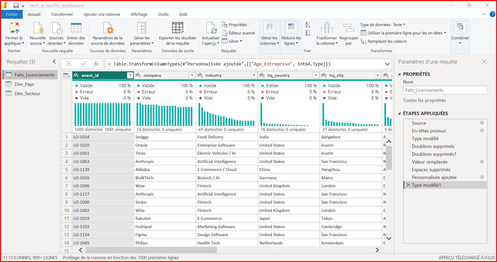
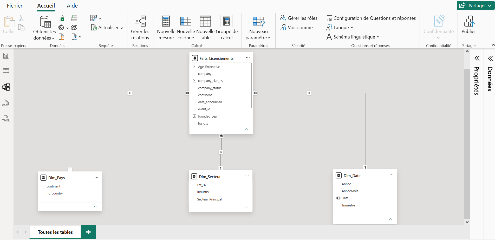
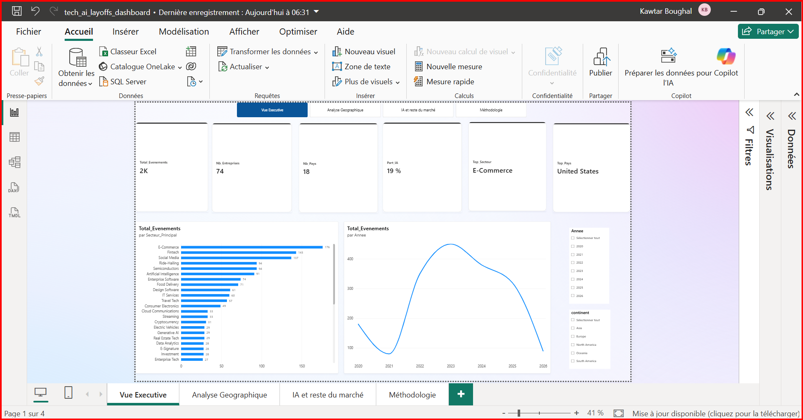
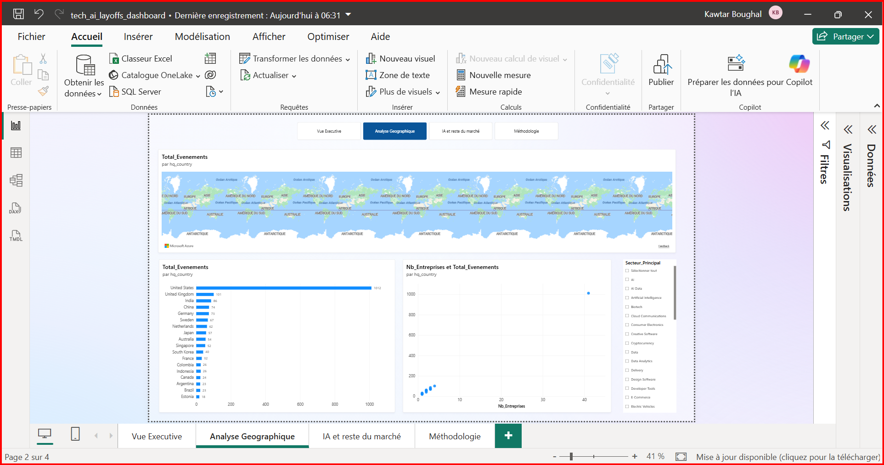
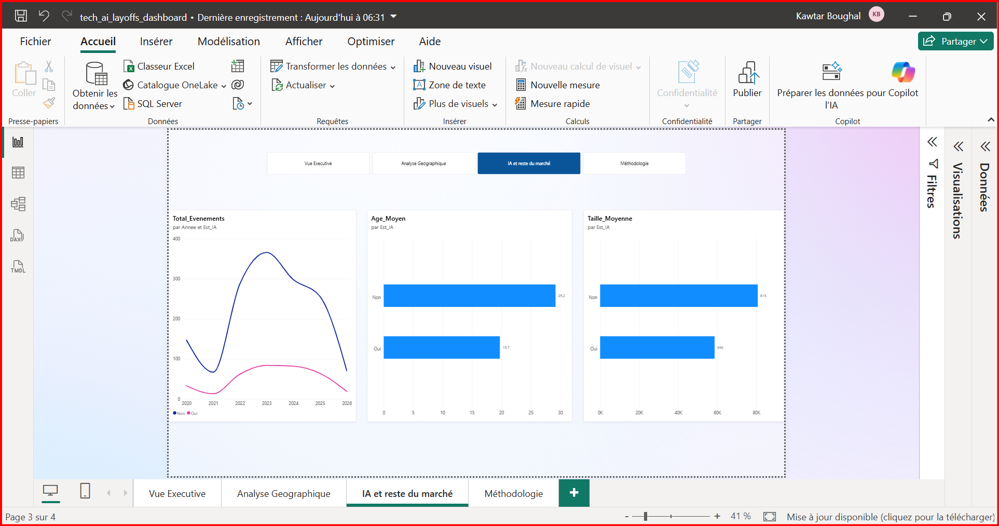

# Rapport final — Licenciements dans la tech et l'IA (2020–2026) : tableau de bord Power BI

**Auteure :** Kawtar Boughal
**Période de réalisation :** octobre 2026
**Dépôt GitHub :** github.com/kawtarboughal02/Projet4_Dashboard_PowerBI_Tech_AI_Layoffs

---

## 1. Résumé exécutif

## 2. Contexte, objectif et problématique

Les annonces de licenciement dans le secteur technologique font l'objet de nombreux commentaires, souvent à partir de chiffres isolés. Un tableau de bord structuré permet de les situer dans le temps, par pays, par secteur et par profil d'entreprise.

**Objectif :** concevoir un tableau de bord Power BI fondé sur un modèle de données robuste et rendre explicites les limites des données.

**Problématique :** comment structurer un pipeline Power Query et un modèle en étoile pour explorer l'évolution des licenciements dans la tech (temps, géographie, secteurs, entreprises liées à l'IA) et en restituer une lecture claire à des publics exécutifs et analytiques ?

Ce projet relève de la Business Intelligence : il est descriptif et ne comporte ni prédiction ni modèle de Machine Learning.

## 3. Données et variables

### 3.1 Source

Le jeu de données est le [Global AI & Tech Layoffs Dataset (2020–2026)](https://www.kaggle.com/datasets/prajitdatta/global-ai-and-tech-layoffs-dataset-20202026), publié sur Kaggle par prajitdatta. La page du jeu décrit 1 850+ événements pour 74 entreprises et 18 pays, ce que confirme l'import. Les conditions d'utilisation et la licence sont indiquées sur cette page. Le fichier brut n'est pas redistribué dans le dépôt.

### 3.2 Variables

| Variable | Description | Type après traitement |
|---|---|---|
| `event_id` | Identifiant de l'événement | Texte |
| `company` | Entreprise | Texte |
| `industry` | Secteur d'activité (libellé parfois composé, par exemple « Fintech / AI ») | Texte |
| `hq_country` | Pays du siège | Texte |
| `hq_city` | Ville du siège | Texte |

## 4. Méthodologie

### 4.1 Nettoyage dans Power Query

Étapes appliquées à la table de faits, visibles dans le panneau « Étapes appliquées » :

1. **Source** et **promotion des en-têtes** ;
2. **Typage** des colonnes (date, nombres entiers, texte) ;
3. **Suppression des doublons** sur `event_id`, pour garantir l'unicité des événements ;
4. **Remplacement des valeurs vides** par « Inconnu » dans les colonnes de texte, afin que ces lignes restent visibles dans les analyses ;
5. **Suppression des espaces** superflus ;
6. **Colonne personnalisée** `Age_Entreprise` = année de `date_announced` moins `founded_year` ;
7. **Typage** de la nouvelle colonne en nombre entier.



*Figure 1 — Requêtes et étapes appliquées dans l'éditeur Power Query.*

### 4.2 Tables de dimension

Deux dimensions sont créées par référence à la table de faits, ce qui garantit des clés cohérentes :

- **`Dim_Pays`** : `hq_country` et `continent`, dédoublonnés sur le pays (18 lignes) ;
- **`Dim_Secteur`** : `industry` dédoublonné, avec deux colonnes calculées : `Est_IA` (« Oui » si le libellé contient « AI » ou « Artificial », « Non » sinon) et `Secteur_Principal` (premier libellé avant le signe « / »).

La table **`Dim_Date`** est générée en DAX à partir des dates minimale et maximale des événements, avec les colonnes `Annee`, `Trimestre` et `AnneeMois`, puis marquée comme table de dates :

```
Dim_Date =
ADDCOLUMNS(
    CALENDAR(
        DATE(YEAR(MIN(Faits_Licenciements[date_announced])), 1, 1),
        DATE(YEAR(MAX(Faits_Licenciements[date_announced])), 12, 31)
    ),
    "Annee", YEAR([Date]),
    "Trimestre", "T" & QUARTER([Date]),
    "AnneeMois", FORMAT([Date], "yyyy-mm")
)
```

### 4.3 Modèle en étoile



*Figure 2 — Modèle en étoile : une table de faits et trois dimensions.*

| Relation | Cardinalité | Sens du filtre |
|---|---|---|
| `Dim_Pays[hq_country]` → `Faits_Licenciements[hq_country]` | Un à plusieurs | Unique |
| `Dim_Secteur[industry]` → `Faits_Licenciements[industry]` | Un à plusieurs | Unique |

## 5. Pages du tableau de bord

### 5.1 Vue exécutive

Destinée à un lecteur pressé : six indicateurs clés (événements, entreprises, pays, part des secteurs liés à l'IA, secteur dominant, pays dominant), classement des secteurs principaux, évolution annuelle du nombre d'événements et segments par année et par continent.



*Figure 3 — Vue exécutive.*

### 5.2 Analyse géographique

Destinée à l'analyse : classement des pays par nombre d'événements, relation entre le nombre d'entreprises et le nombre d'événements par pays, segment par secteur principal.



*Figure 4 — Analyse géographique.*

### 5.3 IA et reste du marché

Compare les événements des secteurs dont le libellé contient « AI » ou « Artificial » (`Est_IA` = « Oui ») aux autres secteurs : évolution annuelle, âge moyen et taille estimée moyenne.



*Figure 5 — Comparaison des secteurs liés à l'IA et du reste du marché.*

### 5.4 Méthodologie

Page de synthèse destinée au lecteur du tableau de bord : source, nettoyage, modélisation et limites.

Une navigation par boutons relie les quatre pages. Le rapport complet est également fourni au format PDF dans `outputs/rapport/`.

## 6. Résultats

Valeurs lues dans le tableau de bord, sélection complète.

### 6.1 Vue d'ensemble


## 7. Lien avec la Data Science et l'IA

Le projet relève de la Business Intelligence. Il illustre la phase qui précède et accompagne la modélisation statistique : préparer des données propres, les structurer dans un modèle fiable, définir des indicateurs sans ambiguïté et en produire une lecture vérifiable.

L'indicateur `Est_IA` est une règle lexicale sur le libellé du secteur. Il permet une comparaison de deux groupes, sans prétendre classer les entreprises avec exactitude. Un prolongement naturel serait une analyse temporelle en Python sur les mêmes données, avec une validation par des sources externes.

## 8. Compétences démontrées

| Compétence | Mise en œuvre |
|---|---|
| Import et nettoyage (ETL) | Power Query : typage, doublons, valeurs vides, colonne calculée |
| Modélisation dimensionnelle | Schéma en étoile, relations un-à-plusieurs, table de dates |
| DAX | Comptages distincts, parts, moyennes, `CALCULATE`, `TOPN`, `ALLSELECTED` |
| Conception de rapports | Deux publics, navigation par boutons, segments, titres explicites |
| Esprit critique sur les données | Limites documentées et formulation prudente des résultats |
| Formation associée | Parcours Microsoft Learn Power BI : modules « Explore the analytics process », « Importez des données dans Power BI », « Configurer un modèle sémantique », « Scope report design requirements » |

## 9. Limites et considérations

1. **Échantillon restreint :** 74 entreprises ne représentent pas l'ensemble du marché technologique mondial.
2. **Régularité inhabituelle :** 1 850 événements pour 74 entreprises donnent exactement 25 événements par entreprise en moyenne, un chiffre très régulier pour des licenciements réels. La méthode de constitution du jeu n'est pas vérifiée dans ce projet ; les résultats sont donc descriptifs et ne doivent pas être lus comme une mesure du marché réel.
3. **Concentration géographique :** environ 55 % des événements concernent les États-Unis et aucun pays d'Afrique n'est présent, ce qui limite toute lecture mondiale.
4. **Unité d'analyse :** le fichier compte des événements, pas des personnes licenciées ; l'ampleur réelle des licenciements n'est pas mesurée.
5. **Année 2026 incomplète :** la fin de série n'est pas comparable aux années complètes.
6. **Indicateur `Est_IA` heuristique :** il repose sur le libellé du secteur et peut mal classer certaines entreprises.
7. **Taille estimée :** `company_size_est` est une estimation dont l'unité n'est pas documentée dans le fichier ; elle est interprétée comme un effectif estimé.
8. **Âge moyen par événement :** l'âge est calculé sur les événements, pas sur les entreprises ; une entreprise qui compte plus d'événements pèse davantage.
9. **Aucune causalité :** les comparaisons ne permettent pas de conclure sur l'effet de l'IA sur l'emploi.
10. **Diffusion :** le tableau de bord est fourni au format Power BI Desktop et en PDF ; il n'est pas publié en ligne.

Avant tout usage décisionnel, il faudrait croiser le jeu avec des sources primaires, disposer du nombre de personnes concernées et valider la couverture des entreprises et des pays.

## 10. Reproductibilité

Prérequis : Power BI Desktop (gratuit, Windows).

1. Télécharger le jeu de données depuis la page Kaggle et l'enregistrer sous le nom `tech_market_raw.csv`.
2. Ouvrir `powerbi/tech_ai_layoffs_dashboard.pbix`.
3. Si la source est introuvable : **Accueil → Transformer les données**, sélectionner `Faits_Licenciements`, ouvrir l'étape **Source** et indiquer le chemin du CSV.
4. **Accueil → Actualiser**.

Les formules DAX et les étapes Power Query décrites ci-dessus permettent de reconstruire le modèle à partir du CSV.

## 11. Conclusion et perspectives

Le projet livre un tableau de bord complet, adossé à un modèle en étoile et à des mesures DAX documentées, et accompagné d'une analyse explicite des limites des données. Il montre une chaîne de Business Intelligence de bout en bout, de l'import à la restitution.

Les suites prioritaires sont : valider le jeu de données par des sources externes, intégrer le nombre de personnes concernées si une source le permet, étendre la couverture géographique, comparer plusieurs définitions du périmètre « IA » et réaliser une analyse temporelle en Python.

---

## English summary

This project builds a four-page Power BI dashboard from a public dataset of 1,850 layoff events across 74 tech and AI companies in 18 countries (2020–2026). It covers the full Business Intelligence workflow: Power Query cleaning (typing, duplicate removal on the event identifier, handling of empty values, a calculated company-age column), a star schema with one fact table and three dimensions linked by one-to-many relationships, DAX measures (distinct counts, share of AI-related sectors, averages, top sector and country), and pages designed for executive and analytical readers.

Recorded results: 19% of events fall in sectors whose label contains "AI" or "Artificial"; E-Commerce is the most frequent main sector (176 events); the United States accounts for 1,012 events (about 55%); event volume is lowest in 2021, peaks in 2023 and declines until 2025, while 2026 is incomplete; companies in AI-related sectors are on average younger at the time of the event (19.7 years against 29.2).

The dataset is a limited sample of 74 companies with an unusually regular 25 events per company, no African country, and no count of people affected. Results are therefore descriptive, the AI flag is a lexical rule on sector labels, and no causal conclusion can be drawn. The project is a Business Intelligence deliverable, not a Machine Learning model.
| Indicateur | Valeur |
|---|---|
| Événements | 1 850 |
| Entreprises | 74 |
| Pays | 18 |
| Part des événements dans des secteurs liés à l'IA | 19 % |
| Secteur principal le plus fréquent | E-Commerce (176 événements) |
| Pays le plus fréquent | États-Unis (1 012 événements) |

### 6.2 Géographie

Les États-Unis représentent 1 012 événements sur 1 850, soit environ 55 %. Viennent ensuite le Royaume-Uni (101), l'Inde (86), la Chine (74), l'Allemagne (73), la Suède (67), les Pays-Bas (62), le Japon (57), l'Australie (54), Singapour (52), la Corée du Sud (40), la France (32), la Colombie (26), l'Indonésie (26), le Canada (24), l'Argentine (23), le Brésil (23) et l'Estonie (18). Aucun pays d'Afrique n'apparaît.

### 6.3 Secteurs

Les secteurs principaux les plus fréquents sont l'E-Commerce (176), la Fintech (143), les réseaux sociaux (137), le VTC (94), les semi-conducteurs (94) et l'intelligence artificielle (91). Le regroupement par `Secteur_Principal` réunit les libellés composés sous leur premier terme.

### 6.4 Évolution dans le temps

Le nombre d'événements est faible en 2021, atteint son maximum en 2023 (plus de 400 événements), puis diminue en 2024 et 2025. L'année 2026 est incomplète : la baisse apparente en fin de période ne doit pas être interprétée comme une tendance.

### 6.5 Secteurs liés à l'IA et autres secteurs

| Indicateur | Secteurs liés à l'IA | Autres secteurs |
|---|---|---|
| Âge moyen des entreprises à l'événement | 19,7 ans | 29,2 ans |
| Taille estimée moyenne | environ 59 000 | environ 81 000 |

Les secteurs liés à l'IA représentent une part minoritaire des événements et concernent en moyenne des entreprises plus jeunes et plus petites. Cette observation décrit l'échantillon : elle ne permet pas d'attribuer ces écarts à l'IA.
| `Dim_Date[Date]` → `Faits_Licenciements[date_announced]` | Un à plusieurs | Unique |

**Justification.** Chaque pays, secteur ou date n'existe qu'une fois dans sa dimension et peut apparaître dans plusieurs événements : d'où la cardinalité un-à-plusieurs. Séparer les dimensions de la table de faits évite la redondance, simplifie les filtres et rend les mesures indépendantes du contexte de présentation.

### 4.4 Mesures DAX

```
Total_Evenements = DISTINCTCOUNT(Faits_Licenciements[event_id])
Nb_Entreprises   = DISTINCTCOUNT(Faits_Licenciements[company])
Nb_Pays          = DISTINCTCOUNT(Faits_Licenciements[hq_country])
Evenements_IA    = CALCULATE([Total_Evenements], Dim_Secteur[Est_IA] = "Oui")
Part_IA          = DIVIDE([Evenements_IA], [Total_Evenements])
Age_Moyen        = AVERAGE(Faits_Licenciements[Age_Entreprise])
Taille_Moyenne   = AVERAGE(Faits_Licenciements[company_size_est])
Top_Secteur      = MAXX(TOPN(1, ALLSELECTED(Dim_Secteur[Secteur_Principal]), [Total_Evenements], DESC), Dim_Secteur[Secteur_Principal])
Top_Pays         = MAXX(TOPN(1, ALLSELECTED(Dim_Pays[hq_country]), [Total_Evenements], DESC), Dim_Pays[hq_country])
```

Les mesures sont évaluées selon le contexte de filtre : elles se recalculent lorsque l'utilisateur change l'année, le continent ou le secteur, contrairement à une colonne calculée qui est figée au chargement.
| `continent` | Continent du siège | Texte |
| `date_announced` | Date d'annonce | Date |
| `founded_year` | Année de création | Nombre entier |
| `company_size_est` | Taille estimée de l'entreprise | Nombre entier |
| `company_status` | Statut de l'entreprise | Texte |
| `Age_Entreprise` *(calculée)* | Année de l'événement moins année de création | Nombre entier |

### 3.3 Unité d'analyse

Chaque ligne est un **événement de licenciement**. Le fichier ne contient pas le nombre de personnes concernées : toutes les analyses comptent des événements et non des salariés.

### 3.4 Premier contrôle qualité

Le profil de colonne initial, calculé sur les 1 000 premières lignes, ne montrait ni erreur ni valeur vide sur les colonnes affichées. Il comptait 74 entreprises, 49 secteurs, 18 pays et 37 villes distincts. Le profil porte sur un échantillon de lignes : il ne remplace pas un contrôle sur l'ensemble du jeu.

Ce projet construit un tableau de bord Power BI de quatre pages à partir d'un jeu de données public recensant 1 850 événements de licenciement dans 74 entreprises de la tech et de l'IA, réparties dans 18 pays, entre 2020 et 2026. L'objectif est double : mettre en œuvre une chaîne de Business Intelligence complète (import, nettoyage, modélisation, mesures, restitution) et produire une lecture claire des données, accompagnée d'une évaluation honnête de leurs limites.

Le travail suit une démarche en cinq temps : nettoyage avec Power Query, modélisation en étoile (une table de faits et trois dimensions), écriture de mesures DAX, conception de pages adaptées à deux publics (lecture exécutive et lecture analytique), puis documentation de la méthode.

Les résultats décrivent l'échantillon : les États-Unis concentrent environ 55 % des événements, le secteur principal le plus fréquent est l'E-Commerce, 19 % des événements relèvent de secteurs dont le libellé contient « AI » ou « Artificial », et les entreprises de ces secteurs sont en moyenne plus jeunes au moment de l'événement. Ces constats sont descriptifs : le jeu de données est un échantillon restreint, présente une régularité inhabituelle (25 événements par entreprise en moyenne) et ne permet aucune conclusion causale.
